# Repasse UX de novembre 2026 : audit des résolutions de PC portable

Audit du 05/11/2026, branche `app` (build de production `108c4cc` servi par `vite preview`, port 4173).

## Méthode

- Chromium (Playwright 1.x), `deviceScaleFactor: 1` (MDPI), locale `fr-FR`. Cinq viewports : **1366×768**, **1280×720**, **1280×800**, **1440×900** et **1536×864** (un écran 1920×1080 à 125 %).
- 17 scénarios par viewport, soit 85 passages : plan avant et après le quiz, liste avant et après le quiz, les 4 fiches demandées, quiz (question, départage, résultat), roadmap vide, roadmap remplie, roadmap avec le Dialog d'ajout ouvert, roadmap défilée de 900 px (sticky), Sources, impression (`emulateMedia print` + PDF A4).
- Pour chaque passage, la sonde mesure : défilement horizontal du document, éléments hors écran, textes rognés, enfants qui débordent de leur parent, libellés de boutons sur plusieurs lignes, histogramme des tailles de police (HTML et texte SVG rendu), chevauchements entre éléments interactifs, nombre de lignes du `h1`, position et part visible du plan, rangées de la légende, bulle des stations extrêmes, comportement de la colonne sticky, position du Dialog.
- Une seconde sonde fait les 16 questions du quiz à chaque viewport et note où arrive le bouton « Question suivante ».
- Les scripts sont restés dans le scratchpad de la session (`sonde.mjs`, `sonde2.mjs`, `captures.mjs`), pas dans `tests-e2e/`. Le scratchpad est vidé entre deux sessions : il faudra les réécrire si on veut refaire la sonde.

### Ce qui va bien

- **Aucun défilement horizontal** : `scrollWidth == clientWidth` sur les 85 passages.
- Aucun texte rogné, aucun élément hors écran, aucun bouton d'action dont le libellé passe à la ligne (barre de navigation, filtres, actions de la roadmap, Dialog).
- Le Dialog d'ajout (520 × 588 px) tient dans l'écran à toutes les hauteurs, avec au moins 66 px de marge à 720 px.
- Aucune erreur dans la console.
- L'impression ne dépend pas de la taille de l'écran : le même rendu A4 sort aux cinq viewports.

## Récapitulatif

| # | Écran | Viewports | Problème | Gravité |
|---|---|---|---|---|
| [1](#1-le-plan-arrive-sous-le-pli) | Plan | tous | Le plan commence entre 336 et 512 px : 31 à 78 % de sa hauteur est visible sans défiler | **Bloquant** après le quiz en 1280×720 et 1366×768, gênant ailleurs |
| [2](#2-lencart-du-résultat-de-quiz-écrase-len-tête) | Plan, liste (après le quiz) | tous | L'encart « Tes 3 lignes de départ » écrase le titre (3 lignes) ou passe sur sa propre rangée, avec la bascule Graphe/Liste isolée | Gênant |
| [3](#3-la-colonne-sticky-compétences-de-la-fiche-ne-colle-pas) | Roadmap | tous | La colonne « Compétences de la fiche » défile avec la page au lieu de rester collée | Gênant |
| [4](#4-quiz--le-bouton-question-suivante-passe-sous-le-pli) | Quiz | 1280×720, 1366×768, 1280×800 | Le bouton « Question suivante » passe sous le pli (15 questions sur 16 en 1280×720) ; idem pour le départage | Gênant |
| [5](#5-en-tête-du-plan--titre-sur-2-lignes-légende-sur-3-rangées) | Plan | 1280×*, 1366×768 | Titre sur 2 lignes, légende des lignes sur 3 rangées en 1280 | Gênant (cause du n° 1) |
| [6](#6-textes-petits--libellés-du-plan-à-11-px-textes-secondaires-de-13-à-15-px) | Plan, fiches, roadmap | tous, surtout 1280 | Libellés du plan à 11,1 px en 1280 (« FORMATION » à 9,3 px) ; 13 à 15 px pour les textes secondaires | Gênant (vidéoprojecteur) |
| [7](#7-écart-avec-la-maquette--le-plan-ne-prend-plus-toute-la-largeur) | Plan | tous | Le plan est rétréci par les marges latérales (1184 px en 1280 au lieu de 1280 dans la maquette) | Cosmétique |
| [8](#8-roadmap--cartes-délément-très-hautes) | Roadmap | surtout 1280×720 | 4 boutons empilés : chaque carte fait au moins 150 px, 2,5 éléments par écran | Cosmétique |
| [9](#9-sources--dates-coupées-au-trait-dunion) | Sources | tous | Les dates (`2025-10`) se coupent au trait d'union | Cosmétique |
| [10](#10-fiche--colonne-de-barres-du-tableau-silkhom-étirée) | Fiches | 1440×900, 1536×864 | La colonne de barres Silkhom s'étire : la fourchette est loin de sa barre | Cosmétique |
| [11](#11-fiche--métiers-voisins-sur-deux-lignes) | Fiches | 1280×* | Un métier voisin sur deux lignes dans la colonne latérale (413 px) | Cosmétique |
| [12](#12-plan--bulle-rognée-cibles-qui-se-chevauchent-ta-formation-qui-déborde) | Plan | tous, surtout 1280 | Bulle rognée en haut de fenêtre, cibles des stations qui se chevauchent de 9 à 11 px, « TA FORMATION » qui touche le bord du disque | Cosmétique |
| [13](#13-impression--marges-noires-dans-le-pdf) | Impression | tous (indépendant) | Marges noires autour de la page A4 quand les arrière-plans sont imprimés | Gênant, à confirmer |

Problèmes vus en passant, sans lien avec la résolution : voir l'[annexe](#annexe--hors-résolution).

## 1. Le plan arrive sous le pli

**Écran** : plan `#/`, avant et après le quiz. **Viewports** : tous. **Gravité** : bloquant après le quiz en 1280×720 et 1366×768 (le moment où les étudiant·es doivent repérer leurs lignes allumées et la zone d'exploration en pointillés), gênant ailleurs.

Mesures (haut du plan dans la page, part de sa hauteur visible sans défiler, stations sous le pli) :

| Viewport | Avant le quiz | Après le quiz |
|---|---|---|
| 1366×768 | haut 380 px · 54 % · 19/68 | haut 480 px · **40 %** · **45/68** |
| 1280×720 | haut 390 px · 50 % · 19/68 | haut 512 px · **31 %** · **53/68** |
| 1280×800 | haut 390 px · 62 % · 12/68 | haut 512 px · 43 % · 45/68 |
| 1440×900 | haut 336 px · 78 % · 2/68 | haut 480 px · 58 % · 17/68 |
| 1536×864 | haut 336 px · 73 % · 3/68 | haut 480 px · 53 % · 19/68 |

Le point connu est **confirmé** : en 1280×800, le haut du plan est à **390 px** (titre sur 2 lignes, légende sur 3 rangées, voir n° 5). Le plan mesure 666 px de haut en 1280 et 714 à 720 px au-delà : même avec un en-tête réduit à 150 px, il ne tient entier dans aucun des cinq viewports, puisqu'il garde le ratio 1280/720 de la largeur disponible. La légende des stations (entrée, évolution, voisins), en bas à droite du plan, n'est jamais visible sans défiler.

La maquette avait déjà ce défaut : l'artboard E1 fait 1280 × 1060 px, le plan y commence vers 340 px.

**Cause probable** : `PlanSvg.tsx:49` (`aspect-[1280/720] w-full`) : la hauteur du plan suit la largeur, jamais la hauteur de la fenêtre. En amont, l'en-tête de `PlanPage.tsx:37-55` occupe 180 à 346 px (n° 2 et 5).

Pistes à trancher (choix de design) : resserrer l'en-tête (titre et filtres sur une rangée, légende des lignes déplacée), plafonner la hauteur du plan à `100dvh` moins la barre (les libellés rapetissent d'autant), ou les deux.

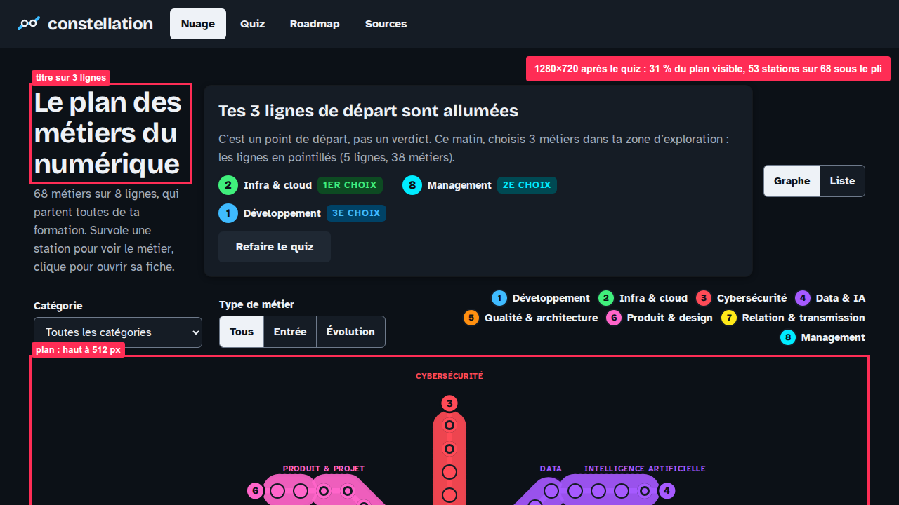

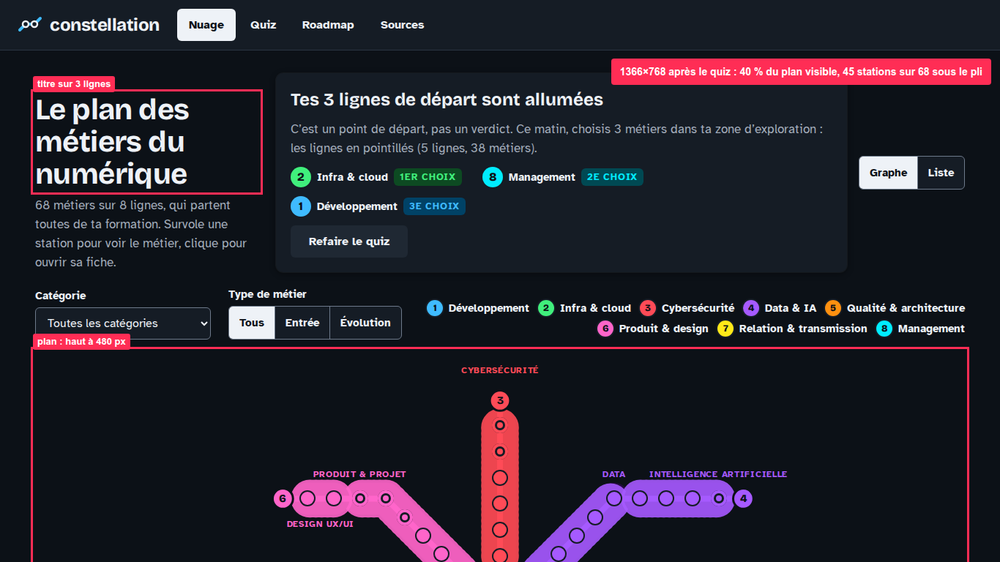

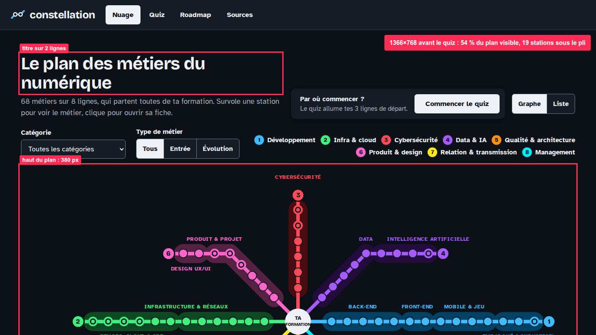

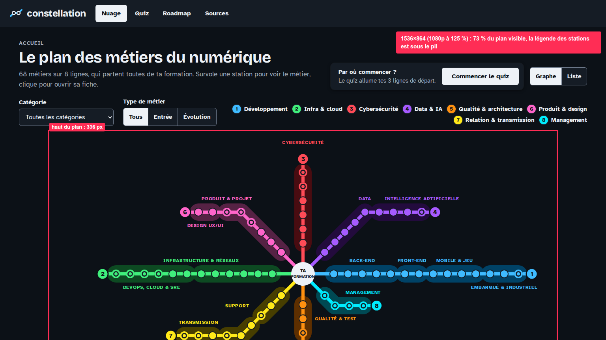

Pages entières : [1280×720 après le quiz](captures/plan-1280x720-apres-quiz-pleine-page.png), [1366×768 après le quiz](captures/plan-1366x768-apres-quiz-pleine-page.png).

## 2. L'encart du résultat de quiz écrase l'en-tête

**Écrans** : plan et liste, après le quiz. **Viewports** : tous. **Gravité** : gênant.

- **Plan** : l'encart (jusqu'à 780 px de large) partage la rangée avec le titre, que `lg:flex-nowrap` empêche de passer à la ligne. Le titre tombe sur **3 lignes** en 1280 et 1366 (2 lignes en 1440 et 1536), le chapeau sur 5 lignes. L'en-tête passe de 224 à **346 px** en 1280, de 180 à 324 px en 1440. C'est ce qui fait descendre le plan de 390 à 512 px (n° 1).
- **Liste** : sans `lg:flex-nowrap`, l'encart part sur sa propre rangée et la bascule Graphe/Liste reste seule à sa droite, centrée verticalement sur l'encart. La recherche arrive à 650 px en 1280×720 ; la première ligne de métiers est sous le pli.

**Cause probable** : `EncartQuiz.tsx:19` (encart du résultat en `max-w-[780px]`, sans largeur minimale ni place prévue), dans le groupe de droite de `PlanPage.tsx:48` et `ListePage.tsx:76` (`md:flex-none`) ; `PlanPage.tsx:37` (`lg:flex-nowrap`).

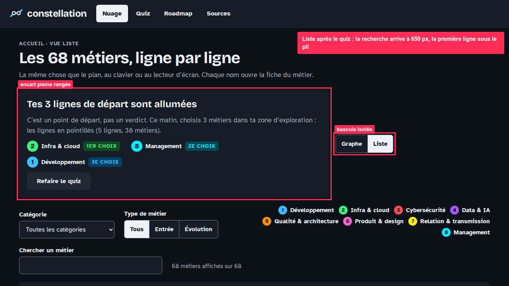

## 3. La colonne sticky « Compétences de la fiche » ne colle pas

**Écran** : roadmap (remplie). **Viewports** : tous (≥ 1024 px). **Gravité** : gênant. Le comportement attendu est documenté dans `Competences.tsx:8` (« colonne sticky » à partir de 1024 px).

Après 900 px de défilement, la colonne a quitté l'écran : `position: sticky; top: 24px` est bien calculé sur `aside[data-competences]`, mais l'élément ne bouge pas.

**Cause probable** : `RoadmapPage.tsx:124` enveloppe `Competences` dans un `
`, et `RoadmapPage.tsx:104` aligne les colonnes en `lg:items-start`. Le conteneur a donc exactement la hauteur de l'`aside` : un élément sticky ne peut pas sortir de son parent, il n'a aucune course. Il faut porter le sticky sur l'enveloppe (ou étirer l'enveloppe à la hauteur de la frise).

Test e2e envisagé : après défilement, `boundingBox().y` de la colonne vaut 24 px.

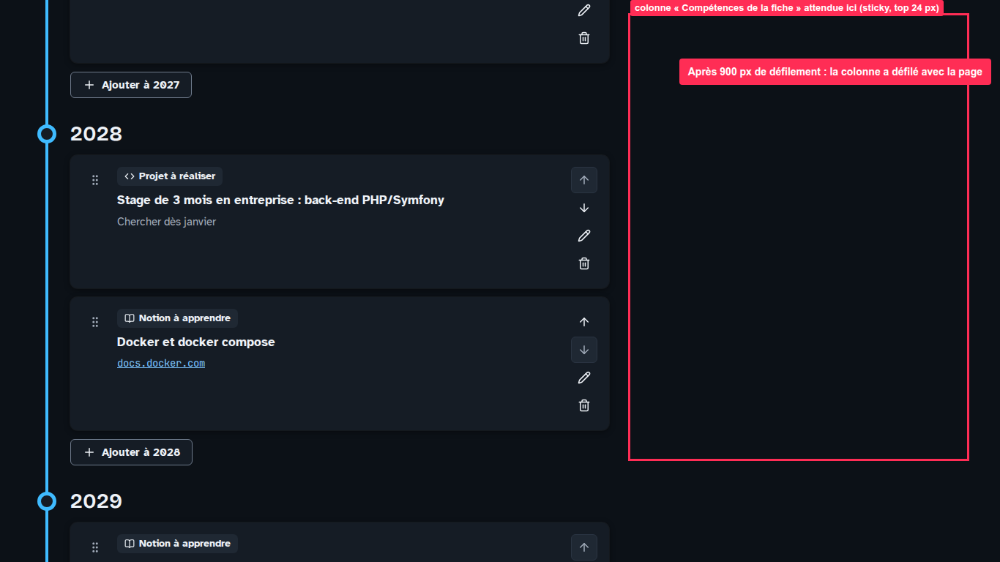

## 4. Quiz : le bouton « Question suivante » passe sous le pli

**Écran** : quiz (questions et départage). **Viewports** : 1280×720, 1366×768, 1280×800. **Gravité** : gênant (il faut défiler pour valider presque chaque question, 16 fois de suite).

| Viewport | Questions dont le bouton est sous le pli | Bas du bouton, au pire |
|---|---|---|
| 1280×720 | **15 sur 16** | 844 px (question 9) |
| 1366×768 | 6 sur 16 (4, 7, 8, 9, 14, 15) | 844 px |
| 1280×800 | 2 sur 16 (4, 9) | 844 px |
| 1440×900, 1536×864 | aucune | |

Le bouton « Voir mon résultat » du départage est aussi sous le pli en 1280×720 (le bouton commence à 705 px).

**Cause probable** : `Question.tsx:46` (`gap-6 py-8`) et la pile verticale : étiquette, barre de progression, compteur, titre de 28 px sur 2 ou 3 lignes, 4 réponses de 66 à 88 px, note, boutons. Même structure dans `Departage.tsx`.

Test e2e envisagé : pour chaque question, le bas du bouton suivant ≤ hauteur de la fenêtre en 1366×768.

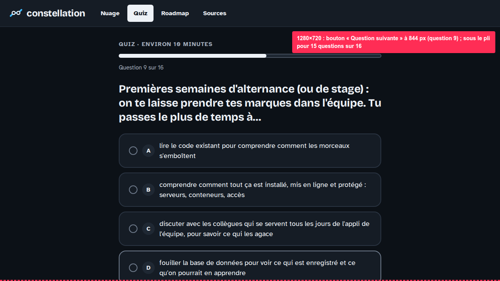

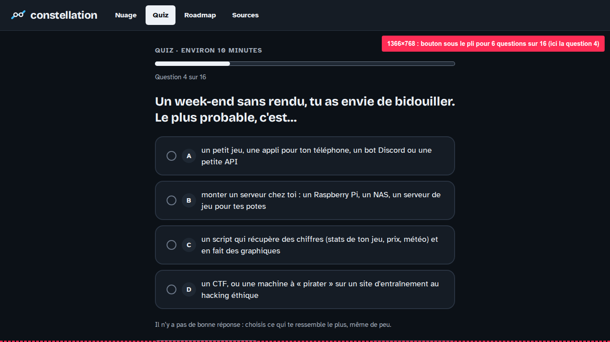

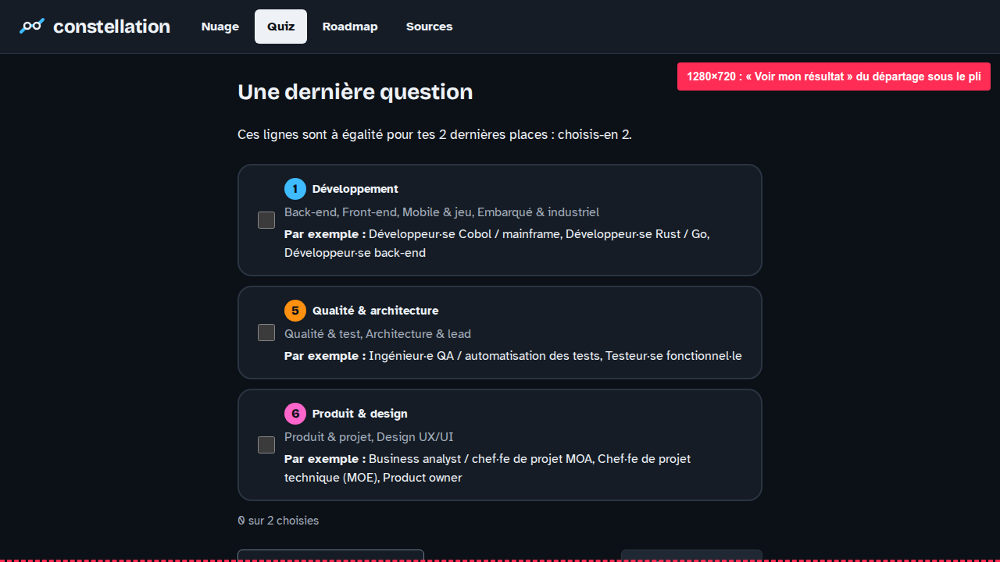

## 5. En-tête du plan : titre sur 2 lignes, légende sur 3 rangées

**Écran** : plan. **Viewports** : 1280×720, 1280×800 (titre et légende), 1366×768 (titre). **Gravité** : gênant, c'est l'une des causes du n° 1.

| Viewport | Lignes du titre | Rangées de la légende (largeur) | Hauteur de l'en-tête |
|---|---|---|---|
| 1280×* | 2 | **3** (659 px) | 224 px |
| 1366×768 | 2 | 2 (745 px) | 224 px |
| 1440×900 | 1 | 2 (819 px) | 180 px |
| 1536×864 | 1 | 2 (915 px) | 180 px |

**Causes probables** :
- titre de 40 px (`titre-1`) dans une colonne qui partage la rangée avec l'encart « Par où commencer ? » et la bascule (`PlanPage.tsx:37-55`) ; il ne tient sur une ligne qu'au-delà de 1400 px environ ;
- légende en `flex-1` dans la rangée des filtres (`Filtres.tsx:89`), après la liste déroulante de 240 px et la bascule de type. Les 8 pastilles demandent environ 1000 px pour tenir sur une rangée.

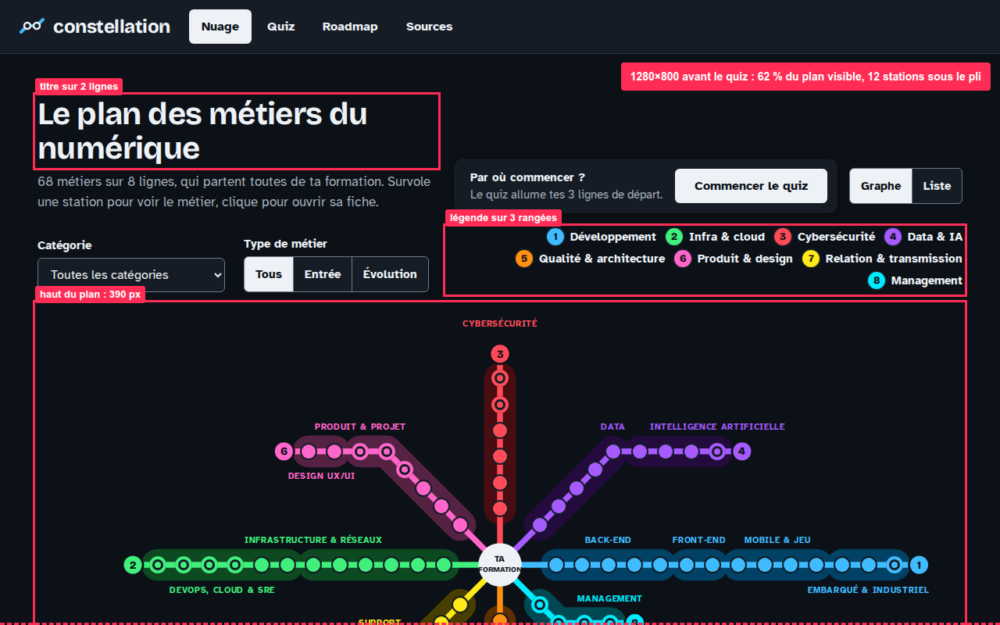

## 6. Textes petits : libellés du plan à 11 px, textes secondaires de 13 à 15 px

**Écrans** : plan surtout, fiches, roadmap. **Viewports** : tous, pire en 1280. **Gravité** : gênant, surtout au vidéoprojecteur.

Le point connu est **confirmé et mesuré** :

- **Libellés du plan (SVG)** : 12 px dans le viewBox, mis à l'échelle de la largeur du plan. Rendus à **11,1 px en 1280**, 11,9 px en 1366 et 12 px au-delà. Les numéros de terminus font 13,9 px, et « FORMATION » au centre **9,3 px** en 1280 (10 px au mieux).
- **Texte HTML** sur l'écran du plan en 1280×800 : 43 % des caractères en 15 px (encart quiz, filtres, bascules, légende) et 14 % en 13 px (étiquette « Accueil », numéros des pastilles). Seul le chapeau est en 17 px.
- **Fiches** : 13 px pour les étiquettes de la colonne latérale (« Métiers voisins, même catégorie »), les numéros de pastille et les graduations Apec ; 14 px pour les badges (type de métier, fiabilité, ROME) ; 15 px pour les sous-titres des cartouches et les sources. Environ 30 % du texte d'une fiche est sous 16 px.
- **Roadmap** : 14 px pour les badges de type et les URL (28 % des caractères), 15 px pour les notes et le statut d'enregistrement.

Ces valeurs viennent de la maquette et passent le contraste AA. Sur un écran 14 pouces en 1366×768, c'est lisible de près ; projeté, et pour les libellés du plan, c'est limite. Le plan rétréci par les marges (n° 7) fait perdre 0,9 px aux libellés en 1280.

**Cause probable** : `PlanSvg.tsx:10` (`fontSize: 12` en unités du viewBox), `PlanSvg.tsx:105` (`fontSize: 10`) ; tailles en dur `text-[13px]`, `text-[14px]` et `text-[15px]` dans `PlanPage.tsx`, `Filtres.tsx`, `EncartQuiz.tsx`, `FichePage.tsx`, `ItemRoadmap.tsx` et `PastilleLigne.tsx`.

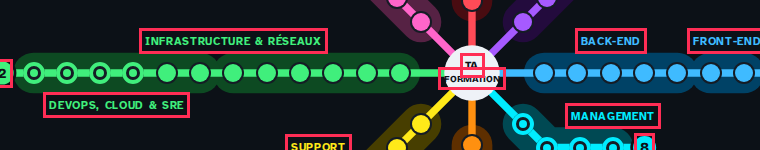

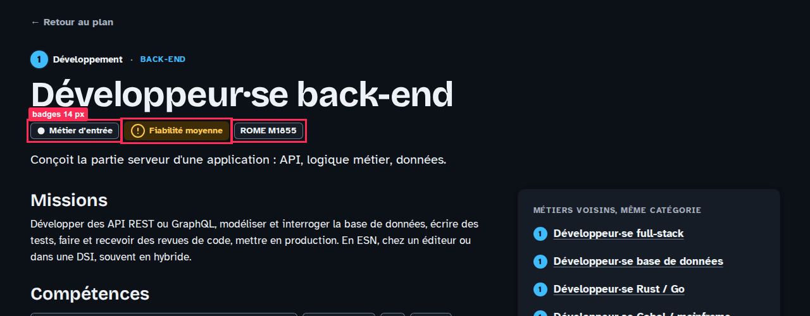

## 7. Écart avec la maquette : le plan ne prend plus toute la largeur

**Écran** : plan. **Viewports** : tous. **Gravité** : cosmétique.

Dans la maquette (E1, E2), le plan occupe toute la largeur de l'artboard (`width: 1280px; height: 720px`, sans marge latérale). Dans l'app, il est dans le `px-12` de la page (`PlanPage.tsx:36`) : 1184 px de large en 1280, d'où des libellés à 11,1 px au lieu de 12 (n° 6). La contrepartie joue en faveur du n° 1 : le plan est 54 px moins haut.

Autres petits écarts relevés dans la rangée des filtres : liste déroulante de 240 px au lieu de 280 px, légende en `gap-x-3 gap-y-1.5` au lieu de `16px` / `8px` (`Filtres.tsx:38` et `:89`).

## 8. Roadmap : cartes d'élément très hautes

**Écran** : roadmap remplie. **Viewports** : tous, sensible en 1280×720. **Gravité** : cosmétique.

Les 4 actions d'un élément (monter, descendre, modifier, supprimer) sont empilées verticalement en boutons de 36 px : une carte fait **au moins 150 px**, même pour un titre d'une ligne. En 1280×720, on voit deux éléments et demi par écran.

**Cause probable** : `ItemRoadmap.tsx:73` (`flex flex-col gap-0.5`), repris du composant `ItemRoadmap` du design system.

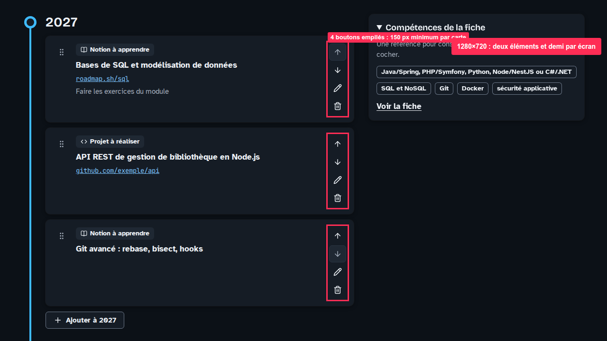

## 9. Sources : dates coupées au trait d'union

**Écran** : Sources. **Viewports** : tous (la page est plafonnée à 1100 px, son rendu est le même partout). **Gravité** : cosmétique.

Dans la colonne « Date », `2025-10`, `2026-06-30`, `2025-12` et `2026-07-07` se coupent en deux lignes au trait d'union (« 2025- » / « 10 »).

**Cause probable** : `SourcesPage.tsx:63`, la cellule `font-mono` n'a pas de `whitespace-nowrap`.

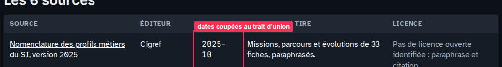

## 10. Fiche : colonne de barres du tableau Silkhom étirée

**Écran** : fiches avec grille Silkhom. **Viewports** : 1440×900 et 1536×864 (tableau de 1304 à 1400 px). **Gravité** : cosmétique.

La colonne de la barre prend toute la largeur restante : en 1536, la fourchette « 30 – 35 k€ » est à 400 px de la barre qu'elle décrit, et la barre fait 730 px pour une plage de 5 k€. La lecture ligne à ligne devient moins directe.

**Cause probable** : `CartoucheSilkhom.tsx`, la troisième colonne n'a pas de largeur plafonnée (les deux premières sont en `w-px whitespace-nowrap`).

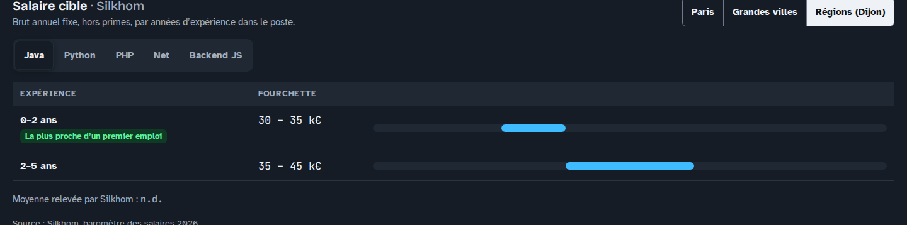

## 11. Fiche : métiers voisins sur deux lignes

**Écran** : fiches (`dev-backend`, `mlops`, `integrateur-web`). **Viewports** : 1280×720 et 1280×800 (colonne latérale de 413 px). **Gravité** : cosmétique.

Un lien de la liste des voisins passe sur deux lignes (« Ingénieur·e QA / automatisation des tests », « Platform engineer / ingénieur·e Kubernetes », « Rédacteur·rice technique (technical writer) »). L'alignement sous la pastille reste propre ; c'est acceptable en l'état.

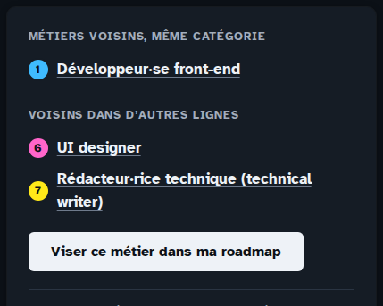

## 12. Plan : bulle rognée, cibles qui se chevauchent, « TA FORMATION » qui déborde

**Écran** : plan. **Viewports** : tous, plus marqué en 1280. **Gravité** : cosmétique.

- La bulle s'affiche toujours au-dessus de la station. Quand la station est près du haut de la fenêtre (après défilement, ce qui arrive avec le n° 1), elle est rognée : −4 px pour « RSSI » en 1280×720 après le quiz. Elle peut aussi recouvrir les filtres (« Évolution »).
- Les liens des stations font 34 × 34 px pour un pas de 30,5 px en 1280 (33 px en 1440) : leurs zones cliquables se chevauchent de 9 à 11 px. La cible reste au-dessus des 24 px de WCAG 2.5.8, mais le survol entre deux stations voisines peut sauter.
- « FORMATION » (9,3 à 10 px) touche les bords du disque central.

**Causes probables** : `PlanSvg.tsx:192` (translation fixe au-dessus de la station), taille fixe `size-[34px]` des liens, `PlanSvg.tsx:105`.

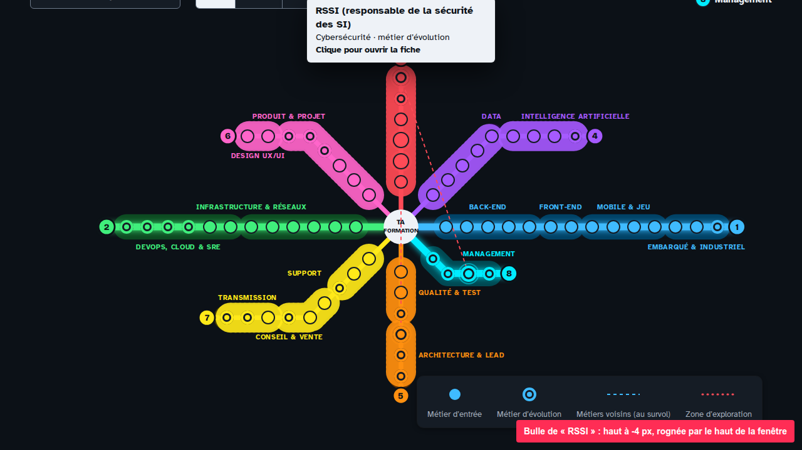

## 13. Impression : marges noires dans le PDF

**Écran** : aperçu d'impression de la roadmap. **Viewports** : sans effet (rendu A4 identique). **Gravité** : gênant si confirmé (encre).

Le contenu imprimé est propre : fond blanc, texte noir, URL complètes, deux pages pour la roadmap de test. Mais le PDF produit avec les arrière-plans (`printBackground: true`, l'équivalent de la case « Graphiques d'arrière-plan ») a des **marges de 15 mm noires** tout autour de la page.

**Cause probable** : `<meta name="color-scheme" content="dark">` (`index.html:6`). Chromium peint la zone des marges `@page` avec le fond du canevas sombre, que `impression.css` ne surcharge pas (le `#fff` ne s'applique qu'à `html` et `body`, pas à la marge de page). À confirmer dans la boîte d'impression de Chrome et d'Edge avec et sans cette case.

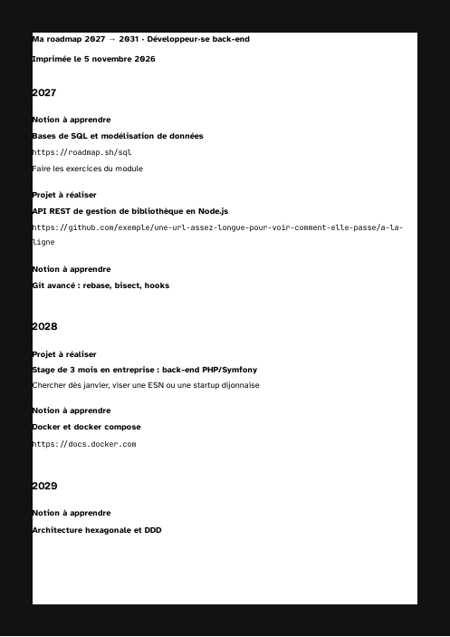

## Annexe : hors résolution

Vus pendant l'audit, sans lien avec la taille de l'écran :

- **Résultat du quiz et départage : « Par exemple : » vide pour la ligne Management.** `exemplesDeLigne` (`Resultat.tsx:15-21`) ne retient que les métiers d'entrée (`type === 'entree'`), et la ligne 8 n'en a aucun. Voir [la capture](captures/quiz-resultat-1280x800-management-sans-exemple.png). C'est le plus visible des points de cette annexe : il apparaît chaque fois que Management est dans le top 3 ou à départager.
- **Boutons Monter et Descendre désactivés** : le bouton désactivé (monter le premier élément, descendre le dernier) apparaît avec un fond, comme s'il était survolé (voir la capture du n° 3). Cause : `button.tsx:9` donne `disabled:bg-surface-muted`, le même fond que `hover:bg-surface-muted` du variant `ghost` (`button.tsx:16`).
- **Tableau Apec des fiches** : les filets entre les lignes ne passent pas sous la première colonne (« Île-de-France », « Autres régions »), visible dans les pages entières des fiches.
- **Contour de focus sur le titre** après un changement d'écran du quiz (focus programmatique sur le `h1`) : visible sur les captures faites sans interaction préalable. À vérifier en conditions réelles (après un clic souris) avant de décider s'il y a quelque chose à corriger.

## Suites

Corrigé le 05/11/2026 sur la branche `app` (commits `230280c..cdcd91a`). Spec : [`2026-11-05-repasse-ux-resolutions-design.md`](../../superpowers/specs/2026-11-05-repasse-ux-resolutions-design.md) ; plan : [`2026-11-05-repasse-ux-resolutions.md`](../../superpowers/plans/2026-11-05-repasse-ux-resolutions.md).

| # | Problème | Correction |
|---|---|---|
| 1 | Plan sous le pli | En-tête compact partagé, légende posée dans le plan, plan plafonné à 300 px en haut |
| 2 | Encart du résultat | Encart réduit après le quiz, en-tête de la liste sans légende |
| 3 | Colonne sticky des compétences | `sticky` sur l'enveloppe, hauteur plafonnée, défilement interne |
| 4 | Bouton « Question suivante » sous le pli | Barre de navigation `sticky bottom-0`, marges de défilement sur l'élément focalisé |
| 5 | Titre et légende de l'en-tête | Légende dans le plan à partir de 1280 px, bouton « Plein écran » |

Annexe, corrigée aussi : exemples de la ligne Management, bouton `ghost` désactivé sans fond de survol, filet bas du tableau Apec. Les n° 6 à 13 restaient ouverts ; les n° 7 à 13 sont traités dans l'étape 3 (plus bas), le n° 6 reste au BACKLOG.

Haut du dessin du plan (`[data-plan-dessin]`, `rect.top + scrollY`, barre de navigation comprise), mesuré le 05/11/2026 sur le build de production (`vite preview`), `deviceScaleFactor: 1`. La part visible est `(hauteur de fenêtre − haut) / hauteur du dessin`. La spec `tests-e2e/mise-en-page.spec.ts` vérifie que le haut est ≤ 300 px et que le centre « TA FORMATION » est visible en 1366×633.

| Fenêtre | Avant le quiz : audit → mesuré | Après le quiz : audit → mesuré | Part visible (avant / après le quiz) |
|---|---|---|---|
| 1366×768 | 380 → **258 px** | 480 → **260 px** | 71 % / 71 % |
| 1280×720 | 390 → **258 px** | 512 → **288 px** | 69 % / 65 % |
| 1280×800 | 390 → **258 px** | 512 → **288 px** | 81 % / 77 % |
| 1440×900 | 336 → **258 px** | 480 → **260 px** | 89 % / 89 % |
| 1536×864 | 336 → **258 px** | 480 → **260 px** | 84 % / 84 % |
| 1366×633 | n.d. → **258 px** | n.d. → **260 px** | 52 % / 52 % |
| 1280×590 | n.d. → **258 px** | n.d. → **288 px** | 50 % / 45 % |

Centre du plan en 1366×633 : le bas du texte « FORMATION » est à 628 px avant le quiz (et avec le départage en attente) et 630 px après le quiz, pour 633 px de fenêtre, donc visible sans défiler dans les trois états. En 1280×590 il ne l'est pas (602 px avant le quiz, 632 px après) : seule la fenêtre de 1366×633 le garantit. Les deux dernières lignes sont des fenêtres réelles (barres du navigateur déduites), absentes de l'audit. Hauteur du dessin : 666 px en 1280, 714 px en 1366, 720 px à 1440 et 1536. Encart du résultat de quiz remis sur trois rangées (pastilles sur une seule, texte et bouton dessous), sans retirer le rappel « point de départ ». Vérifié : 230 tests unitaires, lint, build, 93 e2e passés, 53 ignorés.

Captures après correction :

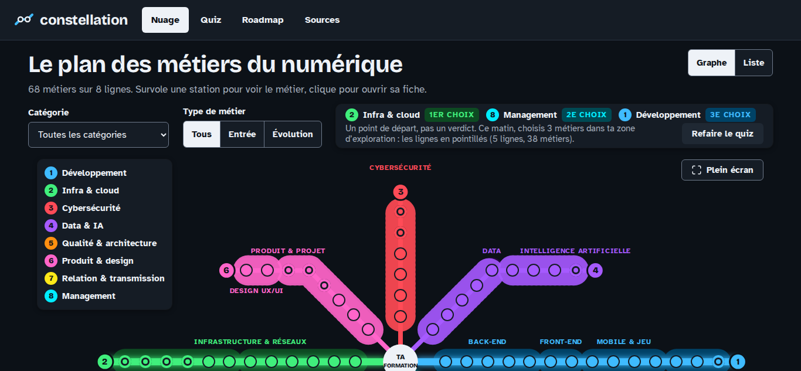

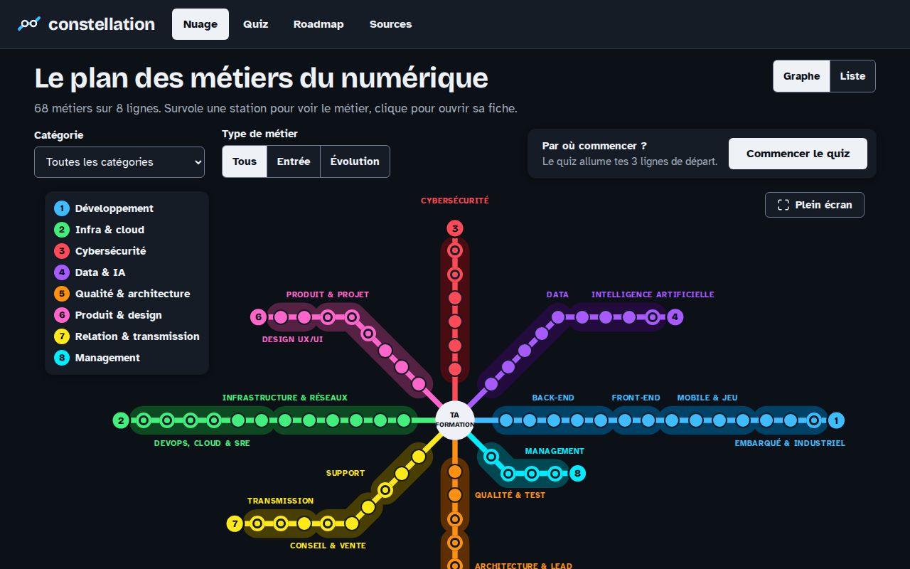

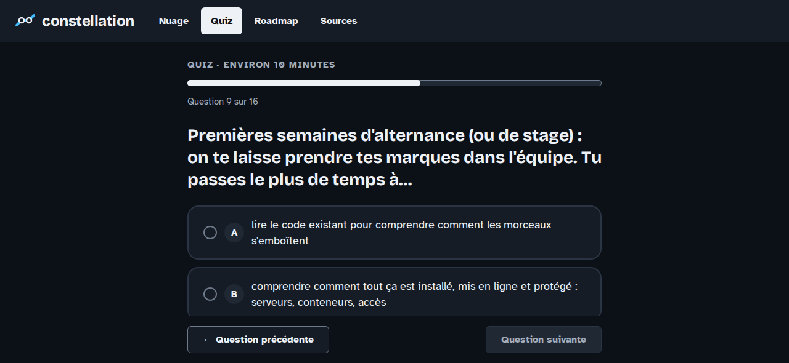

### Étape 3 : cosmétiques n° 7 à 13, et zone d'exploration (n° 14)

Corrigé le 05/11/2026 sur la branche `repasse-ux-cosmetique`, fusionné dans `main` par la PR #5 (merge `cd82e0b`) et publié. Spec : [`2026-11-05-repasse-ux-cosmetique-design.md`](../../superpowers/specs/2026-11-05-repasse-ux-cosmetique-design.md). Plan : [`2026-11-05-repasse-ux-cosmetique.md`](../../superpowers/plans/2026-11-05-repasse-ux-cosmetique.md). Le n° 14 a été ajouté par Adrien : après le quiz, la zone d'exploration attirait plus l'œil que le top 3.

| # | Problème | Correction | Mesure |
|---|---|---|---|
| 7 | Le plan ne prend pas toute la largeur | Le plan sort de la marge de page (plafonné à 1280 px). En-tête en `pt-3`. Légende dans le flux en `gap-x-4 gap-y-2`. **La liste « Catégorie » reste à 240 px** : à 280 px, l'encart du quiz passe à la ligne et le haut du plan monte à 306 px en 1280×590. | Dessin de 1280×720 en 1280 (1184×666 avant) ; libellés à 12 px |
| 8 | Éléments de roadmap très hauts | Les 4 actions passent sur une rangée en haut à droite. Sous `sm`, elles passent sous le contenu. | Cartes de l'exemple de l'audit : 144 / 90 / 90 px en 1280×720. La carte au titre d'une ligne mesurait 182 px avant (1280×800) |
| 9 | Dates coupées au trait d'union | `whitespace-nowrap` | 6 dates sur une ligne |
| 10 | Colonne des barres Silkhom étirée | Piste plafonnée à 640 px. La colonne prend le reste de la largeur, et l'espace libre va à droite de la barre. | Piste de 816 à 640 px en 1536. Écart entre fourchette et piste : de 82 px (première version) à ≤ 32 px. À la demande d'Adrien, la barre est aussi calée sur la ligne de sa fourchette quand le badge « premier emploi » rend la ligne plus haute (décalage vertical de 13 px → ≤ 1 px) |
| 11 | Métiers voisins sur deux lignes | Gardé tel quel (jugé acceptable à l'audit) | — |
| 12 | Bulle rognée, cibles qui se chevauchent, « FORMATION » qui touche le bord du disque | La bulle passe sous la station quand elle sortirait par le haut ; son côté est recalculé à chaque ouverture. Les cibles rondes suivent la largeur du plan (`clamp(24px, 2,75 %, 34px)`). Le dessin de la station suit sa cible et ne prend plus le pointeur. Le disque central passe d'un rayon de 30 à 34. | Bulle de « RSSI » entière quand la station est à 60 px du haut. Aucun point de clic n'ouvre une station plus lointaine que la plus proche (en 1280, 1366 et 1024 : 28, 18 et 54 points fautifs avant) |
| 13 | Marges noires du PDF | `:root { color-scheme: light }` sous `@media print` | Pixel de marge du PDF A4 (`printBackground: true`) : `rgb(18,18,18)` → `rgb(255,255,255)` |
| 14 | Zone d'exploration plus voyante que le top 3 | Fond des quartiers et tracés des 5 lignes hors du top 3 à une opacité de 0,4, sans pointillé. Les stations et les libellés gardent leur plein contraste. L'encart dit « les lignes estompées ». | — |

Haut du dessin et bas du centre « FORMATION », remesurés sur le build de production :

| Fenêtre | Haut avant le quiz | Haut après le quiz | Centre après le quiz |
|---|---|---|---|
| 1366×768, 1440×900, 1536×864 | 254 px | 256 px | 629 px |
| 1280×720, 1280×800 | 254 px | 284 px | 657 px |
| 1366×633 | 254 px | 256 px | **629 px** (fenêtre de 633) |
| 1280×590 | 254 px | 284 px | 657 px (sous le pli, comme avant) |

Avec le départage en attente, les valeurs sont celles d'avant le quiz. En 1366×633, le test exige désormais 2 px de marge sous le centre.

Une relecture finale (Opus) a relevé deux défauts, corrigés avec un test qui échouait d'abord :
- **Bulle** : son côté restait « dessous » quand on resurvolait une station plus bas.
- **Zone de clic** : elle était celle du dessin carré de 34 px, pas celle du disque du lien. Le premier test mesurait le rectangle du lien et passait à tort.

Résultats des vérifications : 231 tests unitaires, lint propre, build, 109 tests e2e passés et 69 ignorés (specs réservées au bureau ou au mobile).

Défaut préexistant relevé au passage et corrigé à la demande d'Adrien : en 1280×720, la pastille « Java/Spring… C#/.NET » débordait de la carte des compétences de la roadmap (droite à 1286 px pour une carte à 1232). Les pastilles passent maintenant à la ligne.

Captures après la correction :

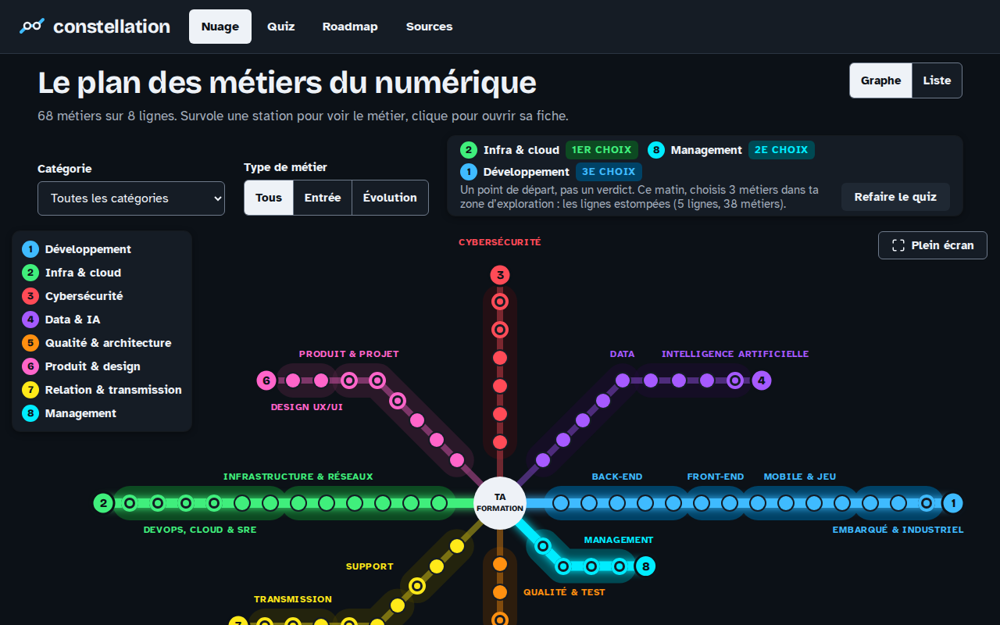

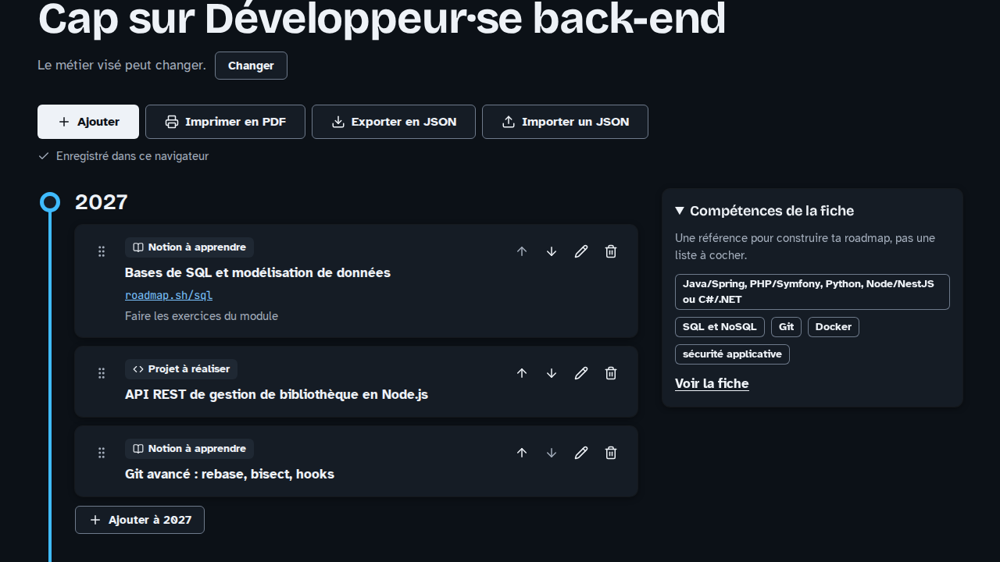

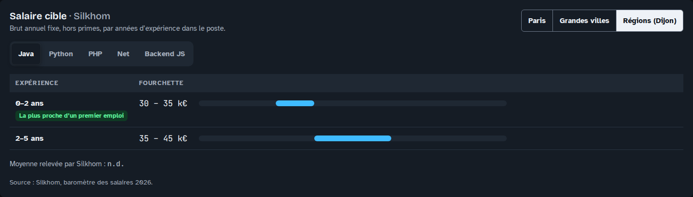
